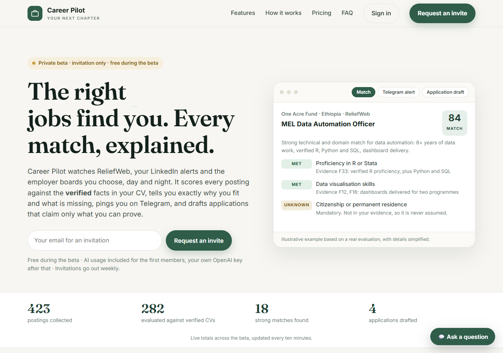
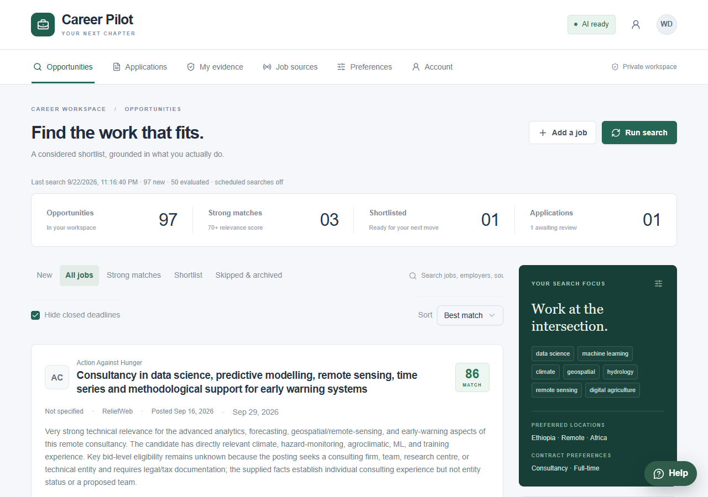
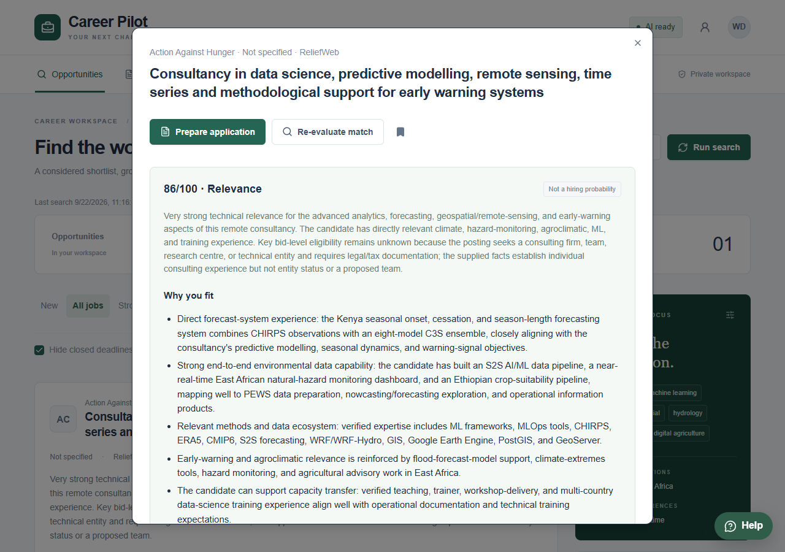
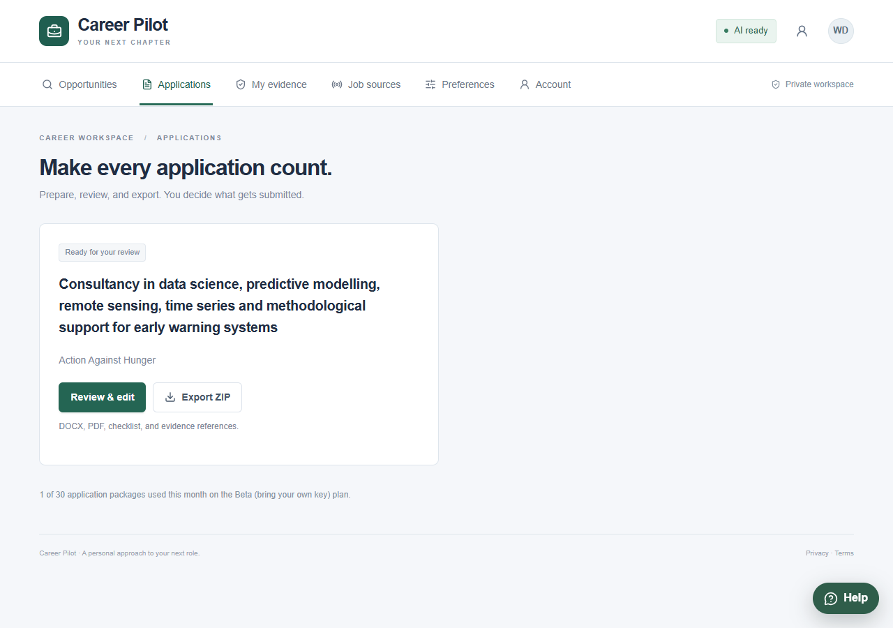
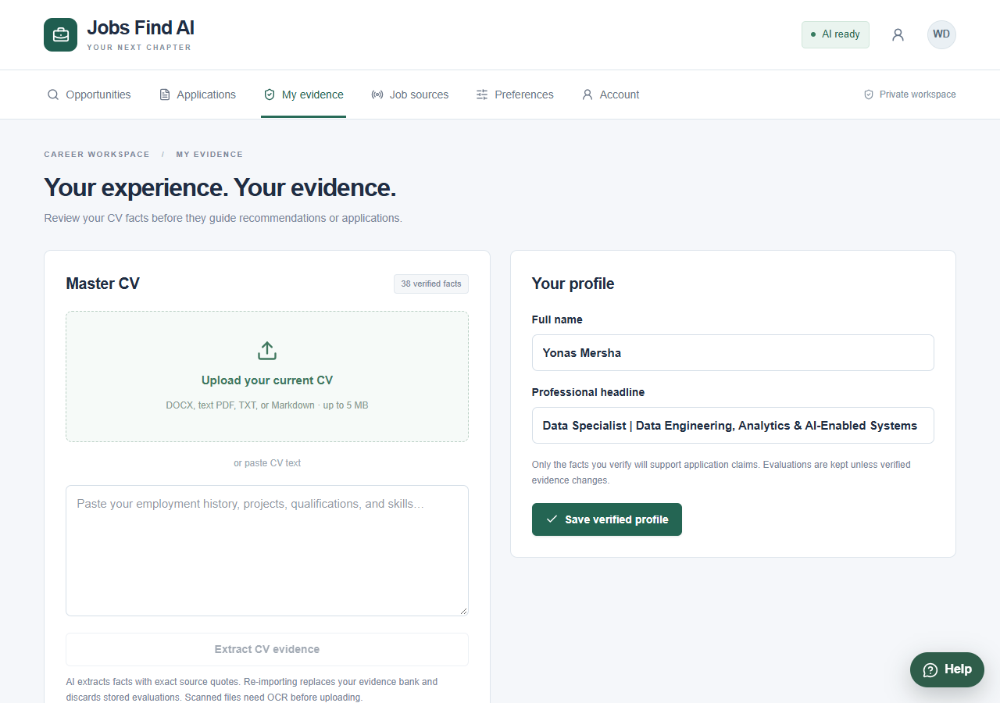
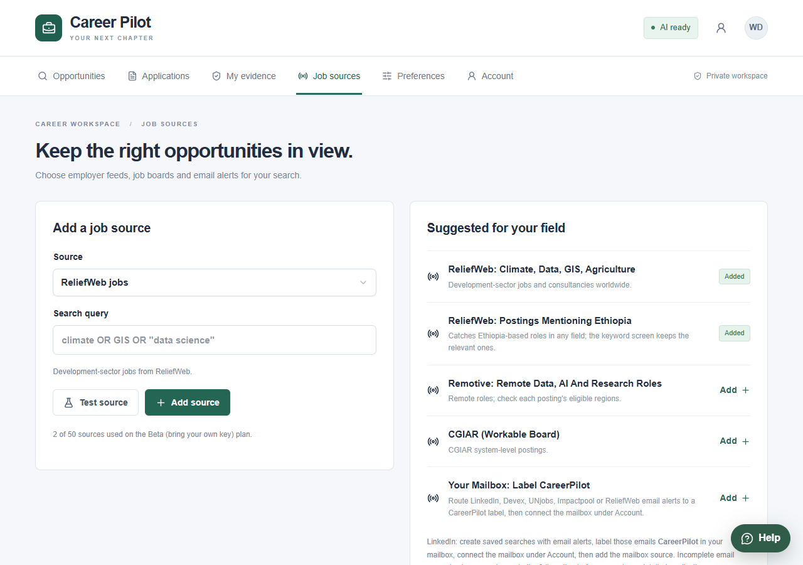

# Jobs Find AI

A personal job discovery and application assistant for data science, AI, geospatial, climate, hydrology, agriculture and development-sector roles.

It collects postings from a shared catalog of public sources and from sources you add, screens them against your keywords, optionally pre-ranks them with JEV, asks an AI to explain requirement by requirement how each posting matches your **verified** CV evidence, alerts you (Telegram, email, in-app inbox), and, only when you click **Prepare application**, drafts a tailored CV, cover letter and screening answers grounded in that evidence for you to review, edit and export.

It never submits anything, never contacts employers, and never invents facts about you.

Version 0.4 serves many people on one server: each account has a private workspace, uses AI included in a sponsored seat or its own OpenAI key, connects its own mailbox for email alerts, and links its own Telegram chat in one tap. During the beta, a limited number of people can join each day without a code; others request an invitation. The first account created becomes the owner and gets the Cohort tab (invitations, plans, shared sources, activation metrics, the blind JEV benchmark). See `docs/DEPLOYMENT.md` for the Render deployment and `docs/CATALOG_DESIGN.md` for the shared catalog.

## Screenshots

| Landing page | Opportunities | Match explanation |
| --- | --- | --- |
|  |  |  |

| Applications | My evidence | Job sources |
| --- | --- | --- |
|  |  |  |

More in [docs/screenshots](docs/screenshots/), including the full landing page and the phone layout. Captured from the live beta with a demo account.

## How it works

1. **Evidence.** Upload your CV. Facts are extracted with exact source quotes. You verify each one. Only verified facts are used anywhere. **Suggest from my CV** proposes keywords and locations from them.
2. **Discovery.** Public postings (ReliefWeb searches and employer boards) are kept once in a shared catalog. Members without sources of their own get recent catalog postings as starter results; the owner curates shared sources; with `CATALOG_SHARED=true` each public source is read once for everyone. On a schedule (default every 6 hours) your own enabled sources are read too. Postings are de-duplicated, screened against your keywords by word stem (so "Data Scientist" matches "data science"), and the most promising unevaluated ones are sent to the AI, up to 50 per search. A few keyword-rejected postings a month are evaluated anyway, to measure what the keywords miss. Postings that have left their source are marked **No longer listed**.
3. **Pre-ranking (optional).** JEV scores each posting on six dimensions against your verified evidence. In shadow mode (`JEV_MODE=shadow`) scores are stored and compared with the AI's; rank mode sends the AI the most promising postings first and holds confident low scores, while a random sample of held postings is still evaluated.
4. **Explanation.** Each evaluated posting gets a 0-100 relevance score, a summary, strengths, gaps, a table of requirements marked met / unknown / not met with the evidence IDs behind each, and what the posting states about seniority, work arrangement, authorisation, visa sponsorship, salary and contract.
5. **Browsing.** Opportunities has List, Cards (swipe right to shortlist, left to skip) and Map (jobs by country) views, with filters on work arrangement, level, contract and stated salary. Shortlisted jobs move through Applied, Interview, Offer and Not selected.
6. **Alerts.** Matches at or above your threshold with no failed mandatory requirement appear in the in-app inbox and, if enabled, are sent to Telegram or email, once per job. Telegram alerts carry **Interested / Skip** buttons.
7. **Application.** From the job dialog, **Prepare application** runs the drafting workflow: evidence gate, draft, independent factual review, one automatic revision if the reviewer objects. You edit in the dashboard and export a ZIP of DOCX and PDF files plus a checklist.

## Windows quick start (local, no Docker)

Requirements: Python 3.11 or 3.12, Node 22+ (only to rebuild the dashboard), an OpenAI API key.

```powershell
python deployment\setup.py                     # creates .env with random secrets (once)
python -m venv .venv
.venv\Scripts\pip install -r backend\requirements.lock
notepad .env                                   # add OPENAI_API_KEY and any of the keys below
.\run.ps1                                      # starts API + dashboard + scheduler on http://127.0.0.1:8000
```

Open http://127.0.0.1:8000/app/ and create the first account, entering `APP_TOKEN` from `.env` as the setup code (or set `OWNER_EMAIL` to restrict the first account to your address). The root URL serves the public landing page from `landing/`. It becomes the owner, and any data created before accounts existed is attached to it. The owner account uses the server's `OPENAI_API_KEY`; other accounts add their own key under **Account**.

To keep it running in the background and start at logon:

```powershell
.\deployment\register_windows_task.ps1         # -Remove to uninstall
```

The in-process scheduler runs while the server runs. Enable **Scheduled searches** in Preferences and set the interval there.

### Rebuilding the dashboard after UI changes

```powershell
corepack pnpm install --frozen-lockfile
corepack pnpm exec vite build --config vite.client.config.ts
Remove-Item -Recurse -Force dashboard; Copy-Item -Recurse dist\dashboard dashboard
```

## Job sources

Add sources under **Job sources**. Use **Test source** before saving to see what a source returns. The **Suggested** list contains sources verified for this sector.

| Kind | Value | Notes |
|---|---|---|
| ReliefWeb | search query, e.g. `climate OR GIS OR "data science"` | Uses API v2 when `RELIEFWEB_APPNAME` is set (request one at https://apidoc.reliefweb.int/parameters#appname). Without it, falls back to the public RSS feed and reads each new job page. |
| Mailbox alerts (IMAP) | optional label/folder (default `JobsFindAI`) | Any account. Route LinkedIn, Devex, UNjobs, Impactpool, ReliefWeb or Indeed alert emails to a `JobsFindAI` label, then connect the mailbox under **Account** with an app password. Needs your AI key. |
| Gmail OAuth alerts | optional Gmail query | Owner account only; needs the Gmail authorization below. |
| RSS / Atom feed | feed URL | Any board that publishes a feed. Short entries are completed from the linked page. |
| Careers page | page URL | A public vacancies page. AI identifies the postings on it; each new posting page is read once. Needs AI. |
| Greenhouse / Lever / Workable / SmartRecruiters / Ashby | employer board identifier | The slug in the employer's board URL, e.g. `cgiar` in `apply.workable.com/cgiar`. |
| Remotive | categories, e.g. `data,artificial-intelligence,research` | Remote roles; check each posting's eligible regions. |

Page-reading connectors fetch only the specific public pages you configure, at most 60 per search with a one-second delay, and never log in anywhere. LinkedIn is not scraped; use its email alerts through Gmail.

### Gmail authorization (for LinkedIn and other email alerts)

Once, in Google Cloud console: create a project, enable the **Gmail API**, configure the OAuth consent screen (External, add your own address as a test user), and create an **OAuth client ID** of type **Desktop app**. Then:

```powershell
.venv\Scripts\python deployment\gmail_setup.py path\to\client_secret_xxx.json
```

The browser opens, you approve read-only access, and `GMAIL_REFRESH_TOKEN` is written to `.env`. Restart the server, create the `JobsFindAI` label and a Gmail filter that applies it to alert emails, then add the Gmail source. Test-mode refresh tokens expire after 7 days unless the consent screen is published; rerun the script if imports start failing.

## Alerts

Notifications are off by default. In **Preferences**, enable alerts, tick channels, choose per-job or digest mode, and click **Send test** on each channel.

**Telegram (recommended).** Create a bot with BotFather and put its token in `TELEGRAM_BOT_TOKEN`. Restart, then under **Account** click **Link Telegram** and **Open Telegram and press Start**: the link carries a one-time code, and the dashboard notices the link within seconds. One bot serves every account on the server; each person links their own chat. The server long-polls Telegram, so no public URL is needed; **Interested / Skip** buttons work on a laptop. Only the linked chat can change job status. HTTPS deployments may instead register a webhook with `python deployment/telegram_setup.py webhook`.

**Email.** Set `SMTP_HOST`, `SMTP_PORT=587`, `SMTP_USER`, `SMTP_PASSWORD`, `EMAIL_FROM`, `EMAIL_TO` (STARTTLS; Gmail needs an app password).

**WhatsApp.** Twilio approved template; see `.env.example`. Sent per job even in digest mode.

Provider acceptance is not delivery confirmation. An alert is recorded before sending and never resent automatically.

## Accounts and plans

- `INVITE_ONLY=true` (default): new accounts need a code from the Cohort tab, except that up to `OPEN_SEATS_PER_DAY` (default 25) people a day can join without one. Set `INVITE_ONLY=false` to open sign-up.
- `SECRET_KEY` encrypts stored API keys and mailbox passwords (defaults to `APP_TOKEN`). Changing it invalidates them.
- Plans (`backend/career/auth.py`): Free, Beta (own OpenAI key), Beta with AI included (the first `SPONSORED_SEATS` members, on the server's key within `SERVER_KEY_MONTHLY_CALLS`), Pro and Pro Plus. The owner can change plans and sponsor seats in the Cohort tab.
- Payments (`backend/career/billing.py`): Chapa (ETB), Lemon Squeezy (cards, USD) or, when neither is configured, a manual request the owner confirms in the Cohort tab. Employers submit a vacancy for a featured listing; after the owner approves it, they pay and follow its views, Apply clicks and matching members at `/employers`, signing in with an emailed link.
- Scripts can still call the API with `Authorization: Bearer <APP_TOKEN>`; that acts as the owner.

## AI

Set `OPENAI_API_KEY` for the owner account. Members add their own key under Account; it is verified against the configured models and stored encrypted. Models are configurable (`EXTRACT_MODEL`, `MATCH_MODEL`, `WRITE_MODEL`). Costs are bounded: at most 50 evaluations per search (most promising first, failed ones retried at most three times then paused for a day), one drafting run per approved application with at most one revision, and descriptions trimmed to 30,000 characters before analysis. Changing your alert threshold or channels never discards evaluations; only changing verified evidence or the keyword, location or contract preferences does.

Without a key, CV text import, manual jobs, non-AI sources and keyword-overlap ranking still work.

## Owner reports

Run on the server (on Render: Shell tab, from `/app`); all are read-only unless noted.

- `python -m career.catalog_report`: catalog size, sources, shared sources, postings no longer listed, starter results.
- `python -m career.jev_report`: the whole funnel, JEV against the AI and members' decisions, confidence calibration, recall by field, cost per good match, cutoff sweep, and the owner's blind benchmark labels. `--models` lists dated JEV models to pin in `JEV_MODEL`.
- `python -m career.business_report`: revenue by month and product (ETB and USD apart), checkout conversion, paying members, the employer funnel with listing views and Apply clicks, institution enquiries, and monthly AI usage; also in the Cohort tab.
- `python -m career.jev_backfill`: rescores evaluated postings after a rubric or model change (uses JEV tokens).
- `python -m career.schedule_reminder`: lists members to remind about scheduled searches; a dry run unless `--send`.

## Docker (optional)

`docker compose up --build -d` starts API, worker, Celery Beat scheduler, PostgreSQL and Redis. In that mode the in-process scheduler is off and Beat runs searches every six hours. Note that Compose publishes port 8000; change the mapping if something else uses it.

## Tests

```powershell
cd backend
..\.venv\Scripts\python -m pytest tests -q
```

Tests use a temporary SQLite database and mocked providers. No network calls, model calls or messages are made.

## Project layout

- `backend/career/main.py`: authenticated API and static dashboard
- `backend/career/sources.py`: all connectors and the suggested-source list
- `backend/career/relevance.py`: stem-based keyword and location screening, evaluation priority
- `backend/career/service.py`: ingestion, de-duplication, search run, alerts, archiving, application workflow
- `backend/career/catalog.py`, `collector.py`: shared catalog, retention rule, shared collection of public sources
- `backend/career/jev.py`, `jev_report.py`, `benchmark.py`: JEV pre-ranking, its validation report, the owner's blind benchmark
- `backend/career/posting_facts.py`, `geo.py`: posting details for filters, country lookup for the map
- `backend/career/billing.py`, `public_jobs.py`, `public_site.py`, `employers.py`: payments, the public job directory, employer listings and their self-service page
- `backend/career/ai.py`: extraction, matching, drafting with independent review and revision
- `backend/career/notifications.py`: in-app inbox, Telegram, email, WhatsApp, digests, test alerts
- `backend/career/telegram.py`: long polling, chat linking, button handling
- `backend/career/scheduler.py`: in-process scheduler and stale-run repair
- `backend/career/documents.py`: CV import and DOCX/PDF export
- `deployment/`: setup, Gmail and Telegram helpers, Windows task registration
- `app/page.tsx`, `app/SwipeDeck.tsx`, `app/JobMap.tsx`: dashboard source; `dashboard/`: compiled dashboard served by the API
- `docs/PLAN.md`: review findings and roadmap; `docs/ARCHITECTURE.md`: data flow and limits; `docs/CATALOG_DESIGN.md`: shared catalog
